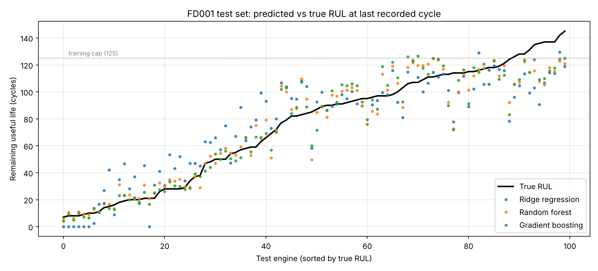
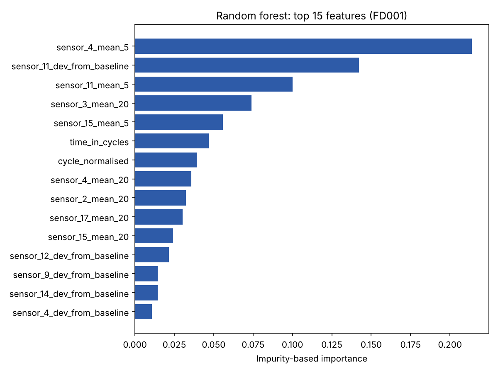

# Turbofan Engine Remaining Useful Life (RUL) Prediction

Predicting how many operating cycles a turbofan engine has left before
failure, using NASA's C-MAPSS run-to-failure dataset.

**Status:** in progress — Phases C1 (data loading and RUL labelling), C2 (feature engineering) and C3 (baseline models) complete.

---

## The problem

Given a stream of sensor readings from an aircraft engine, estimate its
**Remaining Useful Life** — the number of operating cycles before failure.
Predict too high and a degrading engine stays in service. Predict too low
and a healthy engine is pulled for unnecessary maintenance. The two errors
are not equally costly, and the evaluation reflects that.

C-MAPSS is the standard public benchmark for this problem, which means
results here are directly comparable to published work.

## Dataset

Four subsets of increasing difficulty, from the NASA Prognostics Center of
Excellence:

| Subset | Train / Test engines | Operating conditions | Fault modes |
|---|---|---|---|
| FD001 | 100 / 100 | 1 | 1 (HPC degradation) |
| FD002 | 260 / 259 | 6 | 1 |
| FD003 | 100 / 100 | 1 | 2 (HPC + fan) |
| FD004 | 248 / 249 | 6 | 2 |

Each row: `unit_number`, `time_in_cycles`, 3 operational settings, 21 sensors.

Training engines run to failure. Test engine histories are **truncated**
partway through, with ground-truth RUL supplied separately — so the task
is genuinely predictive, not interpolative.

The raw data is not committed here. See [`data/README.md`](data/README.md)
for how to obtain it.

## Key modelling decision: the RUL cap

RUL for training data is derived, not given:

```
RUL at cycle t = (engine's final cycle) - t
```

Left uncapped, this produces a straight line from ~300 down to 0 — which
implicitly asserts that a brand-new engine is detectably different from
one at cycle 50. It isn't. Degradation hasn't started, and the sensors
show nothing distinguishing.

Training against that forces the model to fit a signal that doesn't exist,
and it pays for the invention with accuracy near failure — the only region
that matters operationally.

This project applies the standard **piecewise-linear cap** (default 125
cycles): RUL is held flat while the engine is healthy, and counts down
only once decline is plausible. Set `cap=None` in `add_training_rul()` to
disable it and compare.

## Project structure

```
├── data/
│   ├── raw/              # C-MAPSS .txt files (not committed)
│   ├── processed/        # engineered feature sets
│   └── README.md         # how to obtain the dataset
├── src/
│   ├── config.py           # schema, paths, subset metadata
│   ├── data_loader.py      # loading + RUL labelling
│   ├── features.py         # sensor selection + engineered features (C2)
│   ├── build_dataset.py    # raw files -> feature CSVs
│   ├── metrics.py          # RMSE + NASA asymmetric score (C3)
│   └── train_baselines.py  # grouped CV + test evaluation (C3)
├── tests/
│   ├── make_mock_data.py   # generates format-accurate mock files
│   ├── test_data_loader.py
│   ├── test_features.py
│   └── test_metrics.py
├── results/              # C3 scores, per-engine predictions, plots
└── requirements.txt
```

## Setup

```bash
pip install -r requirements.txt
```

Then follow [`data/README.md`](data/README.md) to place the raw files.

## Verifying the loader without the dataset

The loader is tested against mock files that reproduce C-MAPSS's exact
format, including the trailing-whitespace quirk that produces phantom
columns when read naively:

```bash
python tests/make_mock_data.py
python tests/test_data_loader.py
```

Covers column parsing, RUL derivation for training and truncated test
data, the cap, and constant-sensor detection.

## FD001 at a glance

Verified against the real dataset:

| | Train | Test |
|---|---|---|
| Rows | 20,631 | 13,096 |
| Engines | 100 | 100 |
| Cycles per engine (min / median / max) | 128 / 199 / 362 | 31 / 133 / 303 |

Ground-truth test RUL ranges from 7 to 145 cycles.

**Six sensors are perfectly constant** on FD001 and carry zero information:
`sensor_1`, `sensor_5`, `sensor_10`, `sensor_16`, `sensor_18`, `sensor_19`.
A seventh, `sensor_6`, takes only two distinct values across all 20,631 rows
and is effectively dead weight too. `op_setting_3` is likewise constant —
expected, since FD001 has a single operating condition.

Dropping these is handled in C2 rather than hardcoded, so the same pipeline
works on FD002/FD004 where different sensors vary.

## Feature engineering (C2)

A single sensor reading says little about remaining life. A reading of 47.2
could be healthy or nearly dead depending on where that engine *started* and
which direction it has been moving — C-MAPSS engines each begin with
different, unknown initial wear. Degradation is a trajectory, not a value.

**Sensor selection** applies three filters, fitted on training data only:

| Filter | Dropped on FD001 |
|---|---|
| Zero variance | `sensor_1, 5, 10, 16, 18, 19` |
| Fewer than 10 distinct values | `sensor_6` |
| \|correlation with RUL\| < 0.10 | none |

`sensor_6` is the interesting one: it has non-zero standard deviation but
takes only **two** distinct values across all 20,631 rows (21.60 / 21.61).
A variance-based filter keeps it; a distinct-value filter drops it.
`op_setting_3` is likewise constant, as expected for a single-condition
subset. Filters are empirical rather than hardcoded, so the same pipeline
works on FD002/FD004 where different sensors carry signal.

**Features built** — 116 total, per engine:

- Rolling mean, standard deviation, and trend slope over 5- and 20-cycle
  windows. Two window sizes so the model can weigh responsiveness against
  stability itself.
- Deviation from each engine's own baseline (mean of its first 20 cycles),
  making readings comparable across a fleet with varying initial wear.
- Cycle count.

**Result:** the strongest engineered feature reaches |r| = 0.819 with RUL
versus 0.775 for the best raw sensor, and all of the top 15 features by
correlation are engineered rather than raw.

### Leakage guards

Two failure modes here produce plausible-looking numbers and a useless
model, so both are tested explicitly in `tests/test_features.py`:

- **Cross-engine leakage** — rolling windows are computed within
  `unit_number`, never across the boundary between two engines.
- **Future information** — every window looks strictly backward. A centred
  window would average in future cycles that would not exist at prediction
  time in service.

Total engine lifetime is deliberately excluded from all features: it is
only knowable after failure, so using it would leak the answer directly.

## Baseline models (C3)

```bash
python -m src.build_dataset      # raw files -> features (~30 s)
python -m src.train_baselines    # CV + test evaluation (~4 min)
```

### Protocol

- **Model selection on training data only**, with 5-fold `GroupKFold` split
  by engine. Splitting rows at random would put cycle 100 of an engine in
  training and cycle 101 in validation, and the score would mean nothing.
- **Fixed hyperparameters**, chosen before looking at any score. These are
  baselines for C4 to beat, not tuned results.
- **Test set scored once**, at each engine's last recorded cycle, against
  the true RUL in `RUL_FD001.txt`. Predictions are clipped at 0.

### Results (FD001, 100 test engines)

| Model | CV RMSE (train) | Test RMSE | Test MAE | NASA score | Late predictions |
|---|---|---|---|---|---|
| Mean predictor | 41.67 | 43.07 | 35.90 | 33,629 | 50% |
| Ridge regression | 16.53 ± 0.43 | 17.46 | 14.01 | 461 | 54% |
| Random forest | 12.01 ± 0.51 | 13.06 | 9.61 | 223 | 58% |
| **Gradient boosting** | **10.58 ± 0.51** | **12.88** | **9.33** | **224** | **48%** |

The NASA score is the PHM'08 asymmetric function: with d = predicted − true,
an early call costs e^(−d/13) − 1 and a late call costs e^(d/10) − 1, summed
over engines. Late calls are punished harder because they keep a degrading
engine on the wing. Lower is better.



### What the numbers say

**Error is smallest where it matters.** Test RMSE broken down by true RUL:

| True RUL | Engines | Ridge | Random forest | Gradient boosting |
|---|---|---|---|---|
| ≤ 50 cycles | 33 | 15.0 | 4.8 | **3.3** |
| 50–100 | 34 | 16.0 | 13.4 | 12.7 |
| > 100 | 33 | 20.9 | 17.5 | 18.1 |

Near failure, the tree models are accurate to a few cycles. Most of the
error sits in healthy engines, which is the expected cost of the 125-cycle
cap: the model is trained never to predict above 125, so the 11 test engines
with true RUL between 125 and 145 are under-predicted by design. Scored
against capped truth, gradient boosting's RMSE is 11.7.

**The CV-to-test gap is real but small.** CV RMSE (10.6) scores every cycle of
a held-out engine, including easy ones right before failure. The test set
stops each engine part-way through life. Scoring CV at one random cut-off
per engine instead gives 11.0, closer to the 12.9 seen on test.

**Trees beat linear by a wide margin.** Ridge is 4.6 cycles worse on test
and roughly twice as bad on NASA score. The near-failure region is where the gap
opens most (15.0 vs 3.3), which suggests degradation is non-linear late in
life, as the physics would predict.

**Smoothed sensor levels drive the forest.** The top features are short-window
means of `sensor_4` (LPT outlet temperature), `sensor_11` (HPC outlet static
pressure, plus its drift from baseline), `sensor_3` (HPC outlet temperature)
and `sensor_15` (bypass ratio). Two of the top four sit at the high-pressure
compressor outlet, consistent with FD001's HPC degradation fault mode.



### Context

For reference, published deep models on FD001 report test RMSE around
18.4 (CNN, Babu et al. 2016), 16.1 (LSTM, Zheng et al. 2017) and 12.6
(deep CNN, Li et al. 2018). The gradient-boosting baseline here lands in
the same range. Protocols vary between papers (cap value, how truth is
capped, window lengths), so treat this as a sanity check, not a ranking.

## Roadmap

- [x] **C1** — Data loading, RUL labelling, format verification *(validated on real FD001)*
- [x] **C2** — Feature engineering: rolling statistics, trend slopes, sensor selection
- [x] **C3** — Baseline models (random forest / gradient boosting) + NASA scoring function *(GB test RMSE 12.9)*
- [ ] **C4** — LSTM sequence model *(scope decision pending C3 results)*
- [ ] **C5** — Results write-up and comparison against published benchmarks

## Citation

A. Saxena and K. Goebel (2008). "Turbofan Engine Degradation Simulation
Data Set", NASA Prognostics Data Repository, NASA Ames Research Center,
Moffett Field, CA.
